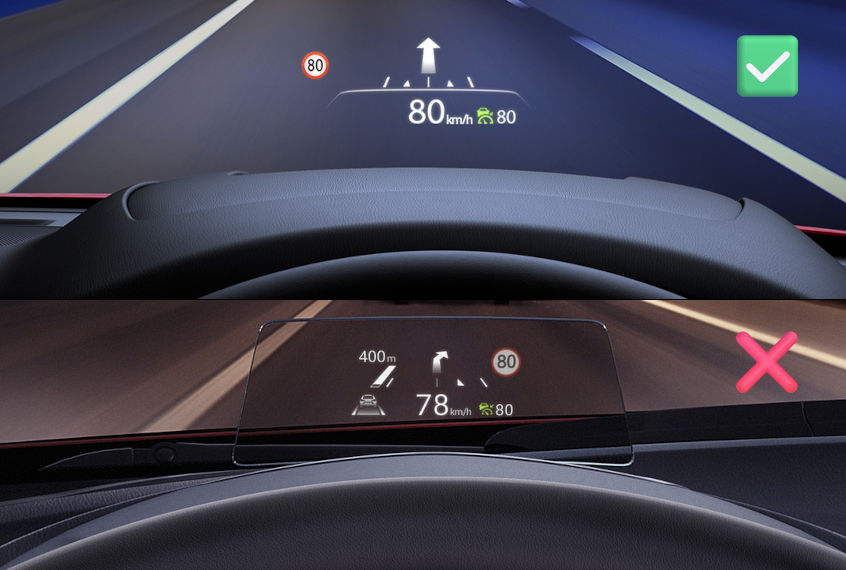
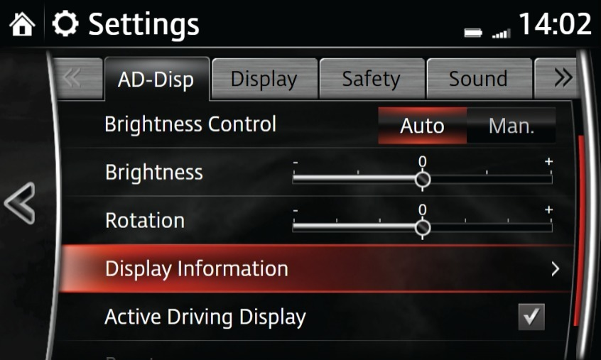
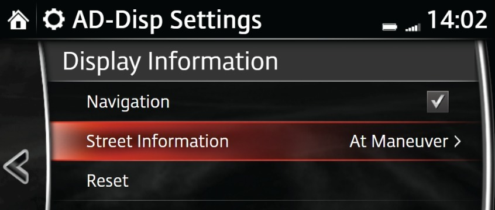
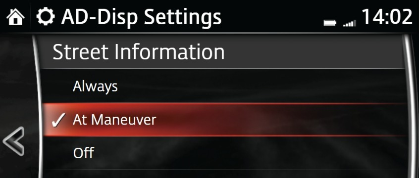
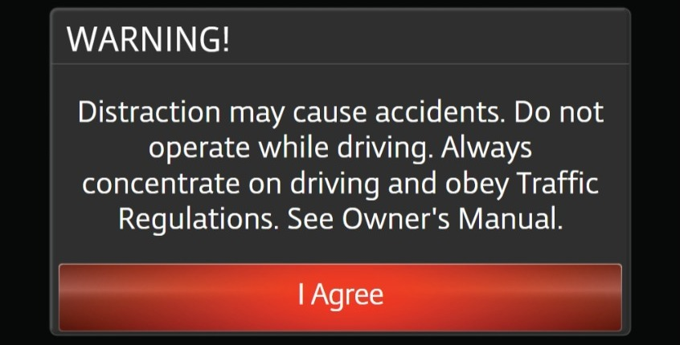

# MZD v74 Tweaks - Mazda CMU Modifications

A collection of tweaks and modifications for the Mazda infotainment system (CMU - Connectivity Master Unit) running firmware version 74.00.324. These mods allow you to customize your Mazda Connect experience with additional features and improvements.

## System Requirements

- **Infotainment System**: MZD Connect (CMU firmware version **74.00.324 only**)
- **USB Drive**: FAT32 formatted USB flash drive (up to 32 GB)
- **Input Device**: USB keyboard for terminal access

## Installation Instructions

1. **Download and Prepare**
   - Clone or download all files from this repository
   - Place all files on a FAT32 formatted USB drive (max 32 GB)

2. **Connect to Vehicle**
   - Start ACC (Accessory mode) without igniting the engine
   - Connect the USB drive to the Mazda USB hub
   - Connect a USB keyboard to the Mazda USB hub

3. **Launch Terminal**
   - Navigate to the Entertainment menu
   - Open USB drive content to play music
   - Wait for the status window to appear and JCI Test Mode to launch
   - Wait for a black screen with buttons to appear
   - Click **NEXT** and then **TERMINAL**

4. **Execute a Script**
   - In the terminal, navigate to the USB drive by typing in the command: `cd /tmp/mnt/sda1` or `cd /tmp/mnt/sdb1` and confirm with ENTER key
   - Optionally, list files to verify contents: `ls`
   - Run the desired script: `sh NAME_OF_FILE.sh`
   - Follow the on-screen prompts
   - Wait 30-120 seconds (or more) for the system to restart
   - If returned to terminal, review `logs` directory and `exit` or `reboot`

## Available Scripts

### 1. `hud-eu-region.sh` - HUD Settings Europe Region Mod
**Purpose**: Enables Active Driving Display hidden settings in the Europe region and non-English/French/Spanish languages - **Street information: Always/At Maneuver/Off** with Windshield Head-Up Display only.









**What it does**:
- Modifies the vehicle settings application to unlock HUD configuration options
- Allows customization of HUD display preferences
- Can be installed or uninstalled reversibly

**Installation/Uninstall**:
- Run the script and choose "Install" or "Uninstall" when prompted
- Original system files are automatically backed up before modification
- Logs are saved to `logs/install.log` or `logs/uninstall.log`
- After reboot navigate to **Settings** > **Active Driving Display** > **Display Information**

**Issues**:
- *Street Information* menu is grayed out - your HUD doesn't support displaying road name

### 2. `no-more-disclaimer.sh` - No More Disclaimer Mod
**Purpose**: Removes entirely the disclaimer/warning screen that appears on the system startup. With the stock behavior it disappears in 3.5 seconds.



**What it does**:
- Modifies the system application to skip disclaimer prompts
- Provides a cleaner boot experience without interruptions
- Can be installed or uninstalled reversibly

**Installation/Uninstall**:
- Run the script and choose "Install" or "Uninstall" when prompted
- Original system files are automatically backed up before modification
- Logs are saved to `logs/install.log` or `logs/uninstall.log`

### 3. `backup-jci.sh` - JCI Full System Backup
**Purpose**: Creates a complete backup of the JCI system directory.

**What it does**:
- Creates a ZIP archive of the entire `/jci` directory
- Automatically checks for sufficient free space on USB drive

**Requirements**:
- At least 170 MB of free space on USB drive

**Output**:
- Backup file: `JCI-[VERSION].zip`
- Log file: `logs/backup.log`
- Use this backup to restore your system to a known-good state

### 4. `revert-aio.sh` - Uninstall AIO base Tweaks only
**Purpose**: Removes previously installed base modifications of AIO (All-In-One) Tweaks from your system. It doesn't remove the targeted mods. Remove them with AIO scripts.

**What it does**:
- Restores original configurations:
  - `/jci/sm/sm.conf` - System Manager configuration
  - `/jci/opera/opera_home/opera.ini` - Opera browser settings
  - `/jci/opera/opera_dir/userjs/fps.js` - Frame rate settings
- Verifies file integrity before completion
- Logs all operations for troubleshooting

**Running**:
- Run the script and confirm when prompted
- System will reboot automatically upon completion
- Check `logs/uninstall.log` if errors occur

## File Structure

```
mzd-v74-tweaks/
├── README.md                          # This file
├── images/                            # Screenshosts for documentation
├── hud-eu-region.sh                   # HUD settings modification script
├── no-more-disclaimer.sh              # Disclaimer removal script
├── backup-jci.sh                      # System backup script
├── revert-aio.sh                      # AIO tweaks uninstaller
├── jci-mods/                          # Modified application files
│   ├── vehsettingsApp.js              # Modified vehicle settings app
│   └── systemApp.js                   # Modified system app
├── jci-org/                           # Original backup files
│   ├── vehsettingsApp.js.org          # Original vehicle settings app
│   └── systemApp.js.org               # Original system app
├── js/                                # JavaScript utility files
│   └── run.js                         # Execution script
├── mp3/                               # Audio files for testing
|   └── a.mp3, b.mp3, c.mp3, d.mp3     # Audio test files
└── mp3title.txt                       # Metadata for audio loading
```

## Common Issues & Troubleshooting

### "no such file or directory"
- **Cause**: USB drive not detected or incorrect path
- **Solution**:
  - Verify USB drive is properly connected to the Mazda USB hub
  - Try the alternate path: if `sda1` doesn't work, try `sdb1`
  - Ensure USB drive is formatted as FAT32 and not larger than 32 GB
  - Check the path is typed correctly (case-sensitive)

### "command not found"
- **Cause**: command is misspelled or incorrect syntax
- **Solution**:
  - Type the command carefully, paying attention to capitalization and spacing

### "sh: 0: cannot open ...: No such file"
- **Cause**: misspelled filename
- **Solution**:
  - Verify the exact filename: use `ls` to list files
  - Ensure you're using the correct script name with the `.sh` extension
  - Type the command carefully, paying attention to capitalization and spacing
  - Press TAB key to autocomplete the filename

## Technical Details

### How Installation Works
1. Scripts disable the hardware watchdog to prevent timeout during operations
2. File system is remounted in read-write mode
3. Original system files are backed up with `.org` extension
4. Modified files are copied to system directories
5. File integrity is verified after copying
6. System automatically reboots to apply changes

## Support & Debugging

If you encounter issues:
1. Check the log files in the `logs/` directory
2. Verify your firmware version is exactly 74.00.324
3. Ensure USB drive is properly formatted (FAT32)
4. Try a different USB port on the vehicle
5. Review the error messages in the dialog boxes carefully

## Disclaimer

These modifications alter system files on your Mazda infotainment system. Use at your own risk. Always create backups before installing any modifications. The author is not responsible for any damage or issues resulting from the use of these tweaks.

## License

Original modifications by the community.
The terminal access based on https://github.com/shunceyb/mzd74-tweaks-no-touch.
MZD UI changes tested and screenshoted with https://github.com/ScorpAL/mzd-emu.
