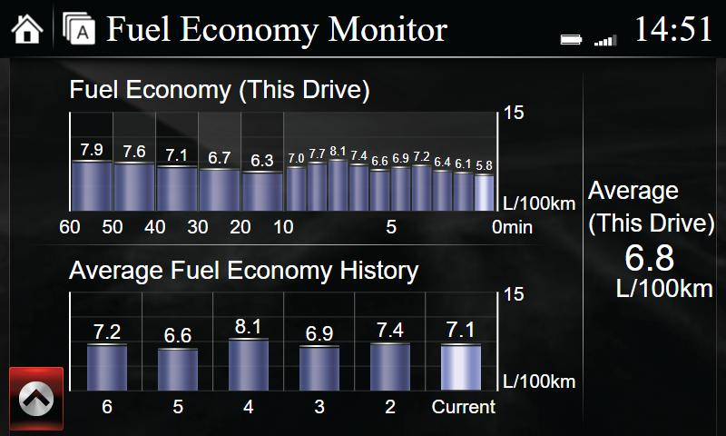
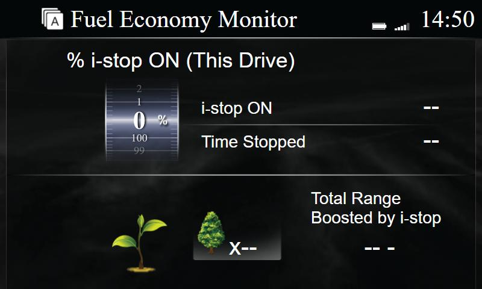
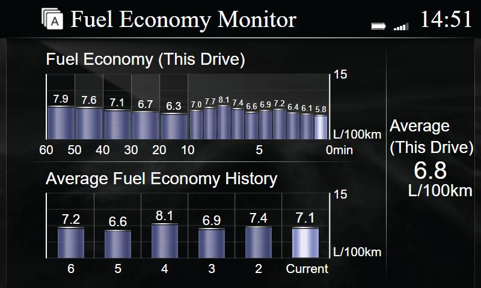

# Fuel Consumption tweaks – details, build and patch instructions

Three independent tweaks for the Fuel Consumption app (`fuel-consumption.sh`). Tested in a Mazda 6 (GJ, 2019, EU), CMU 74.00.324A, with i-stop + i-ELOOP and cylinder deactivation.

| Tweak | Changes |
|---|---|
| **Bar values** – the L/100km value above every bar of both graphs | `/jci/gui/apps/ecoenergy/controls/FuelConsumption/js/FuelConsumptionCtrl.js` ← `jci-mods/FuelConsumptionCtrl.js` |
| **Fuel ending screen** – at ignition off show the Fuel Consumption screen instead of the i-stop screen, for 7 s instead of 5 s | `/jci/gui/apps/ecoenergy/js/ecoenergyApp.js` ← `jci-mods/ecoenergyApp.js` |
| **Fuel ending data** – on i-stop cars the ending screen also gets its data (graphs filled) | `/data_persist/fuel-ending/fuel_ending_mmui.so` ← `jci-shims/fuel_ending_mmui.so`, plus one LD_PRELOAD line for `jciMMUI` in `/jci/sm/sm.conf` and `sm_WCP.conf` |

| | Stock | Tweak |
|---|---|---|
| Fuel Consumption screen |  |  |
| At ignition off (i-stop car) |  |  |

Screenshots from the [mzd-emu](https://github.com/ScorpAL/mzd-emu) emulator with test data.

## How it works

### Fuel ending screen and data

With "Show screen at ignition off" enabled, the screen is chosen in `/jci/mmui/uia/libjciuiaecoenergy.so` (MMUI). There is no setting for it. The ending state machine checks two guards, in this order: `UIA_ECOENERGY_isPrevEngRunNEndingSetOnNEndingIsEffectiveness`, then `...IsFuelConsumption`. Both read the equipped-feature type:

| Feature type | Ending screen |
|---|---|
| `ISTOP`, `ISTOP_IELOOP`, `ISTOP_MHYBRID` | i-stop effectiveness |
| `NONE`, `IELOOP`, `MHYBRID` | fuel consumption |
| HEV | its own guard (untouched) |

`ecoenergy_dbus_start_EndingScreenStatus` then asks the EEM service (`/jci/eem/svcjcieem.so`) for data with `EEM_SetEEMUpdateScreenEnable(handle, code, cb, 0)`. Code **11** sends the i-stop data, code **12** sends the fuel data (`SendDrvAvgFuelEconomy`, `Drv1AvlFuel_BarGraph`, `CumlAvgEfficiencyReset_BarGraph`, `CumlFuelEff_Current`). These are the same four senders the normal fuel screen (code 8) uses. Code 11 is used nowhere else.

- **`ecoenergyApp.js`** wraps `handleContext`: an `EndingEffectiveness` context is shown as `EndingFuelConsumption`. It also changes `_startEndingTimer` from 5000 to 7000 ms. Only the GUI times the ending screen: it sends `EndingTimeout`, and the MMUI has no timeout of its own. Without the shim, only the "Current" value is filled, because EEM still sends the i-stop data.
- **`fuel_ending_mmui.so`** (LD_PRELOAD for `jciMMUI`) interposes three functions:
  - Effectiveness guard → 0,
  - Fuel guard → original fuel OR original effectiveness,
  - `EEM_SetEEMUpdateScreenEnable`: 11 → 12.

  This works because the state table reaches the guards through `R_ARM_ABS32` symbol relocations, and the EEM call goes through the PLT.
  - The originals are found in the defining library's own dynamic symbol table (`dl_iterate_phdr`, GNU/SYSV hash), never via `dlsym`, so the shim cannot call itself.
  - Nothing runs at load time. If anything is not found, the stock behaviour is kept.
  - `jciMMUI` is `reset_board="yes"`, so a crash would reboot the head unit. The shim only acts at ignition off.

### Bar values

`FuelConsumptionCtrl.js` gets a `_modSetBarLabel()` helper, called from `_setCFERGraphBarHeight(s)` (history bars) and `_setCDFEGraphBarHeight(s)[Right]` (this-drive 1-min and 10-min bars). It adds a label inside each bar `div`, so the label follows the bar and its animations. The HEV branches are untouched.

- The graph areas clip at 109 px, so a tall bar gets its value inside the bar.
- The 1-min bars are only 21 px wide, so they use a smaller font, and 4-character values (e.g. `12.8`) are slightly tighter.
- The 1-minute slide animation ends with Presto's `oTransitionEnd`, which calls `_setCDFEGraphBarHeights` and so redraws the labels. Chrome-based emulators do not fire this event.

## Files and checksums

Every file the installer brings has an `.md5` next to it (`md5sum` format). The installer reads the expected values from these files, and CI checks that every `.md5` matches its file.

| File | md5 |
|---|---|
| `jci-org/ecoenergyApp.js.org` (original on the head unit) | `32f3607cbbbb0532f28bb726882e990b` |
| `jci-mods/ecoenergyApp.js` | `65b6008c19b52041232e0ead96ad22a6` |
| `jci-org/FuelConsumptionCtrl.js.org` (original on the head unit) | `9b0443778acc8ab1ac89ea6561f1b153` |
| `jci-mods/FuelConsumptionCtrl.js` | `266f2fb5876cc89287efda4cdc8ad52e` |
| `jci-shims/fuel_ending_mmui.so` | `554ca237fcf6f11dbdd8b34d142ca544` |
| `/jci/mmui/uia/libjciuiaecoenergy.so` (checked on the head unit) | `ac44a5f1bbcbe32d83d4076e6e6f4562` |
| `/jci/mmui/svcjcimmui.so` (checked on the head unit) | `3b63fa37aa2ae4989c1febaa18c1f292` |

If you change `fuel-consumption.sh`, a `jci-mods` file or a shim, update its `.md5` (`md5sum file > file.md5`). CI fails otherwise.

## Creating the modified JS files yourself

The scripts in `jci-patches/` create the `jci-mods` files from the originals and check the md5 of the input:

```sh
python3 jci-patches/ecoenergyApp-patch.py         jci-org/ecoenergyApp.js.org         jci-mods/ecoenergyApp.js
python3 jci-patches/FuelConsumptionCtrl-patch.py  jci-org/FuelConsumptionCtrl.js.org  jci-mods/FuelConsumptionCtrl.js
```

CI runs the same commands and checks that the output equals `jci-mods/`.

## Building the shim

You normally don't need to. The `Release` workflow builds it with the toolchain pinned by the `mazda/m3-toolchain` submodule, and opens a PR when `jci-shims/` changes.

Locally (Linux x86_64):

```sh
git submodule update --init mazda/m3-toolchain   # uses Git LFS
sh build/build.sh                                # or: sh build/build.sh /path/to/m3-toolchain
```

`build/build.sh` compiles every `mazda/patches/<name>/*.c` into `jci-shims/<name>.so` and writes `jci-shims/<name>.so.md5`. The build is reproducible: the same source gives the same md5 wherever the repo is checked out. Shims may only link against libc/libdl/libpthread. On this old glibc, `clock_gettime` lives in librt, so use `time()`.

## Testing

- The JS changes were tested in mzd-emu: data injected with `framework.routeMmuiMsg`, the ending triggered with `framework.debug.fakeCtxtChgMsgs('ecoenergy','EndingEffectiveness',...)`.
- The shim was tested in qemu against the real `libjciuiaecoenergy.so` (with stubbed dependencies), calling the real state-table entries and `ecoenergy_dbus_start_EndingScreenStatus`.
- `fuel-consumption.sh` was simulated in busybox with the real `sm.conf` files: install, reinstall, uninstall, skip, exit, damaged files, unknown originals, other firmware, other preload on `jciMMUI`, missing `.md5`.
- All three tweaks are installed and working in the car mentioned above.
